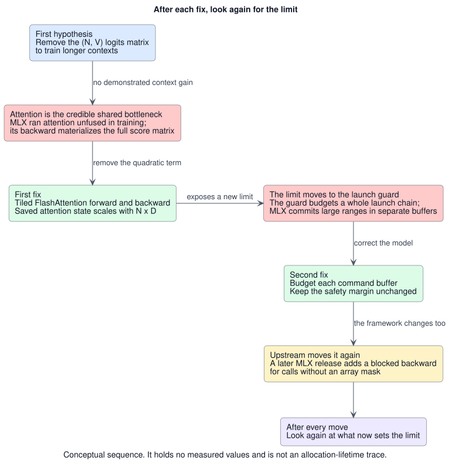

# When the Bottleneck Moved: From Fused Cross-Entropy to FlashAttention on MLX

*A case study from `mlx-train-perf`: a removed allocation, two corrected system models, and an upstream release that moved the limit again*

> 📄 [Read on the website](https://ineshin.space/papers/when-the-bottleneck-moved/) — same paper, formatted for reading.

## Update, 2026-11-14: what changed in this paper

The [July 2026 version](https://github.com/IonDen/mlx-train-perf/blob/v0.9.1/docs/papers/when-the-bottleneck-moved.md)
of this paper built its argument on figures from runs whose records were not published with the
code. An [update on 2026-11-13](https://github.com/IonDen/mlx-train-perf/blob/2deff631171b457f072dae923cc8268bf5af5363/docs/papers/when-the-bottleneck-moved.md)
added an account of MLX 0.32.4 and repeated two of those figures. This version replaces both.

It no longer sets a 25.68 GiB training step against a 12.75 GiB one ("close to a twofold
reduction in total peak"), and it drops the 7,936 against 23,040 token contexts (2.9×), the 0.99×
throughput ratio and a launch cap "near 10,000 tokens". On 2026-11-13 the project withdrew the
25.68 GiB peak, those two contexts and their ratio, the 0.99× ratio and the launch cap, because no
record published with the code showed them at the time
([changelog](https://github.com/IonDen/mlx-train-perf/blob/fc45488b21d0f476ee7b2b0e56ce3120b9317ed0/CHANGELOG.md)).
Two more are dropped here for their own reasons. The comparison with the 12.75 GiB step goes
because that step keeps its record but differs from the 25.68 GiB one in both attention and loss
(section 6). The 21.39 GiB tie on MLX 0.31.2 goes because nothing published shows it. The MLX
0.31.2 attention probe is gone too.

On 2026-11-14 the project published six sets of July run records, with a
[note on each](https://github.com/IonDen/mlx-train-perf/blob/fc45488b21d0f476ee7b2b0e56ce3120b9317ed0/evidence/2026-07-run-records/README.md):
the MLX 0.31.2 loss pairs and the four surviving points of an MLX 0.31.2 context search,
flash-attention and stock-attention steps on MLX 0.32.0, a context sweep on MLX 0.32.0, and a
command-buffer probe. They do not bring the old comparisons back. The 25.68 GiB step is in the
stock-attention set. The 12.75 GiB step is in the flash-attention set and in the records already
at v0.9.1, each from a different session than the 25.68 GiB step. The two steps change attention
and loss together. The stock-attention run with the fused loss at that length aborted. The
23,040-token sweep point reports `ok` with a non-finite second loss, and the same sweep holds two
launch-budget refusals (section 6).

Other records are still missing: nothing published shows the 21.39 GiB tie, the attention probe
or the 0.2.0 chain cap's refusals. The command-buffer probe's record is published, but it names no
MLX runtime version and no script fingerprint, so this paper does not use it (section 10).

Section 2 now uses the surviving MLX 0.31.2 records, and section 5 compares the two losses under
flash attention. The context-sweep table is gone; section 6 says what the sweep's records do and
do not show. The MLX 0.32.4 account is corrected. Its source shows calls without an array mask,
not only causal ones, taking the new backward, and calls with no mask were not measured.

Every figure used as an example names its run and the release tag or commit that holds its record.

---

Removing a large allocation does not necessarily move a system's memory ceiling. It moves the
ceiling only when that allocation is alive at the peak.

`mlx-train-perf` began as a fused cross-entropy loss for MLX fine-tuning. It removed the logits
matrix, and we expected a longer trainable context. We could not demonstrate one. The MLX source
and the way the attention peak grew pointed instead to a credible shared bottleneck: the attention
backward, which MLX ran unfused in training. We wrote a tiled FlashAttention path for Metal, and
our own launch guard became the next limit. After we fixed the guard, MLX shipped a lighter
attention backward of its own. Each fix was real, and after each one we had to ask again what set
the limit.

This paper is a case study in bottleneck migration and measurement correction. It does not claim a
new attention algorithm: the online-softmax and recompute schedule comes from
[FlashAttention](https://arxiv.org/abs/2205.14135). The contribution is a causal
grouped-query-attention (GQA) training integration for Qwen/Llama-class `mlx-lm` fine-tuning on
pre-NAX Apple hardware, the generations before the M5's Neural Accelerators. With it comes the
evidence trail that shows how two plausible system models failed.

The examples come from records committed at the repository's release tags, from the run records
it published on 2026-11-14, and from MLX source at its release tags; section 10 lists each example
with its record. The machine is an Apple M1 Max with 32 GB of unified memory. The project README
states it, and so does the project's note on the July records; among the records themselves, only
the community benchmark record names the chip. Nothing was rerun for this write-up.



*Figure 1. The three moves this paper follows. Conceptual: no measured values, and not an
allocation-lifetime trace.
[Editable PlantUML source](https://github.com/IonDen/mlx-train-perf/blob/main/docs/papers/diagrams/bottleneck-migration-concept.puml).*

## 1. The first hypothesis: remove the logits, train longer

For sequence length `N`, hidden dimension `D`, and vocabulary size `V`, a conventional output layer
forms logits with shape `(N, V)`:

```text
logits = hidden @ W.T
loss_i = logsumexp(logits_i) - logits_i,target_i
```

The fused loss avoids that matrix. It streams over vocabulary tiles, updates an online log-sum-exp,
captures the target logit, and returns only per-token vectors; its backward recomputes the tiles it
needs, so the matching gradient disappears too. This removes a real allocation.

With a large vocabulary, the logits and their gradient are among the biggest tensors in a
training step, and they grow with every token. If they disappear, a longer sequence should fit
before the machine runs out of memory. We tested that on a
4-bit Qwen3-8B QLoRA fine-tune with gradient checkpointing on MLX 0.31.2, against `mlx-lm`'s stock
loss in otherwise identical runs. Section 2 gives the result.

## 2. The result that did not fit

The fused loss freed memory at a given length. In 20-step runs on MLX 0.31.2 that differ only in
the loss, it lowered the step's marginal peak at 2,048 tokens from 3.75 to 3.03 GiB, on top of
4.29 GiB already held (records
[`seq2048_stock`](https://github.com/IonDen/mlx-train-perf/blob/fc45488b21d0f476ee7b2b0e56ce3120b9317ed0/evidence/2026-07-run-records/bench_train_step_gradckpt/train_step_mlx-community__Qwen3-8B-4bit_seq2048_stock.json)
and [`seq2048_ours`](https://github.com/IonDen/mlx-train-perf/blob/fc45488b21d0f476ee7b2b0e56ce3120b9317ed0/evidence/2026-07-run-records/bench_train_step_gradckpt/train_step_mlx-community__Qwen3-8B-4bit_seq2048_ours.json)).
At 1,024 tokens it did not lower it: 2.15 GiB fused against 2.12 GiB stock (records
[`seq1024_ours`](https://github.com/IonDen/mlx-train-perf/blob/fc45488b21d0f476ee7b2b0e56ce3120b9317ed0/evidence/2026-07-run-records/bench_train_step_gradckpt/train_step_mlx-community__Qwen3-8B-4bit_seq1024_ours.json)
and [`seq1024_stock`](https://github.com/IonDen/mlx-train-perf/blob/fc45488b21d0f476ee7b2b0e56ce3120b9317ed0/evidence/2026-07-run-records/bench_train_step_gradckpt/train_step_mlx-community__Qwen3-8B-4bit_seq1024_stock.json)).
These July records carry the project's label: recorded (records published 2026-11-14; chip and run
date annotated).

What the fused loss did not do was extend the longest context that fit. That frontier is the
longest sequence at which a two-step training probe completed. The
[driver of that MLX 0.31.2 search](https://github.com/IonDen/mlx-train-perf/blob/e5c810eb196a4a4442c3703d7869d70c0c3e06ab/scripts/northstar_context_sweep.py)
changes only the loss between its arms, and its SHA-256 matches the script fingerprint in each of
the search's surviving records. The [later driver at v0.9.1](https://github.com/IonDen/mlx-train-perf/blob/v0.9.1/scripts/northstar_context_sweep.py)
shows how the search works: it doubles the length, then bisects. Its arms change attention as well
as the loss, though, so it illustrates the bisection, not this experiment. The first release recorded the
result as a known limit in its
[0.1.0 changelog](https://github.com/IonDen/mlx-train-perf/blob/fc45488b21d0f476ee7b2b0e56ce3120b9317ed0/CHANGELOG.md): "The fused
loss frees memory at a given context but does not, on its own, extend the maximum trainable context
on MLX." The same entry named the cause we had settled on, the backward of
`mx.fast.scaled_dot_product_attention`, which materialized the full attention matrix.

Four points survive, all from that same MLX 0.31.2 search. The fused loss completed
8,448 tokens
([record](https://github.com/IonDen/mlx-train-perf/blob/fc45488b21d0f476ee7b2b0e56ce3120b9317ed0/evidence/2026-07-run-records/pre-rc-refresh-backup-2026-07-12/northstar_context_sweep/northstar_mlx-community__Qwen3-8B-4bit_seq8448_ours.json))
and failed at 8,704
([record](https://github.com/IonDen/mlx-train-perf/blob/fc45488b21d0f476ee7b2b0e56ce3120b9317ed0/evidence/2026-07-run-records/pre-rc-refresh-backup-2026-07-12/northstar_context_sweep/northstar_mlx-community__Qwen3-8B-4bit_seq8704_ours.json));
the stock loss completed 8,704
([record](https://github.com/IonDen/mlx-train-perf/blob/fc45488b21d0f476ee7b2b0e56ce3120b9317ed0/evidence/2026-07-run-records/pre-rc-refresh-backup-2026-07-12/northstar_context_sweep/northstar_mlx-community__Qwen3-8B-4bit_seq8704_stock.json))
and failed at 8,960
([record](https://github.com/IonDen/mlx-train-perf/blob/fc45488b21d0f476ee7b2b0e56ce3120b9317ed0/evidence/2026-07-run-records/pre-rc-refresh-backup-2026-07-12/northstar_context_sweep/northstar_mlx-community__Qwen3-8B-4bit_seq8960_stock.json)).
Both failures are worker crashes with Metal's "Insufficient Memory" error. The two completed points
peaked at 26.23 and 26.47 GiB. Both are above 24.96 GiB, the wired limit recorded before the
benchmark reset its cap to 20 GiB, so the pair shows neither a safe capacity nor a reliable
regression. No other point from that search survives.

So the fused loss gave no demonstrated context extension. That does not show the logits were
absent from the peak. The frontier observations cannot say whether the logits overlapped it: the
search resolves the frontier only to its final 256-token interval, and a smaller peak can still
leave the next length failing. We did not trace allocation lifetimes. Section 3 shows why the MLX
source and the way the attention peak grows made attention a credible shared bottleneck.

## 3. Finding what replaced it

The first clue was an inline probe of one causal `mx.fast.scaled_dot_product_attention` call: its
forward, measured on its own outside training, stayed small, while forward plus backward grew much
faster than the sequence. Its numbers were not kept; the MLX source and a later benchmark show
what it pointed at.

In [MLX 0.31.2](https://github.com/ml-explore/mlx/blob/v0.31.2/mlx/backend/metal/scaled_dot_product_attention.cpp#L598-L602)
and [MLX 0.32.0](https://github.com/ml-explore/mlx/blob/v0.32.0/mlx/backend/metal/scaled_dot_product_attention.cpp#L601-L605),
the Metal attention sends every training call to the unfused path: "It's faster for training on
Metal to use the unfused SDPA for both forward and backward." The VJP had no GPU implementation: its
fallback check returns true and its GPU entry point throws `NYI`, on
[0.31.2](https://github.com/ml-explore/mlx/blob/v0.31.2/mlx/backend/metal/scaled_dot_product_attention.cpp#L788-L795)
and [0.32.0](https://github.com/ml-explore/mlx/blob/v0.32.0/mlx/backend/metal/scaled_dot_product_attention.cpp#L792-L799)
alike. Under training, both the forward and the backward ran as ordinary composed operations (the
first version of this paper called that forward memory-light; it was not). The upstream pull
request that later replaced this path says the fallback "uses a lot of memory since it allocates a full [context_size x context_size] attention matrix"
([ml-explore/mlx#4563](https://github.com/ml-explore/mlx/pull/4563)).

The library's [attention memory benchmark](https://github.com/IonDen/mlx-train-perf/blob/v0.9.1/scripts/bench_attention_marginal.py)
measures the marginal peak of one attention forward plus backward (bf16, 32 query and 8 key/value
heads, head dimension 128, batch 1, causal mask, median of three calls after a warm-up). On MLX
0.32.0 the stock call peaks at 0.241, 0.848, 3.219 and 12.532 GiB at 1,024, 2,048, 4,096 and 8,192
tokens ([records at v0.9.1](https://github.com/IonDen/mlx-train-perf/tree/v0.9.1/_artifacts/bench_attention_marginal/mlx-0.32.0)).
Each doubling multiplies the peak by 3.5 to 3.9×, close to the fourfold growth of an `N²` matrix,
for one call in one layer.

These records are MLX 0.32.0, taken in October 2026; no record of the call on 0.31.2 survives, but
the source shows the same training path on both releases. Size, growth, the same attention in both
loss arms, and the source made the attention backward the credible shared term. The missing piece
was a memory-efficient attention backward, not a better loss.

## 4. What the FlashAttention schedule changes

For one attention head, standard scaled dot-product attention is

```text
S = scale · Q Kᵀ + mask
P = softmax(S)
O = P V
```

A straightforward training implementation stores or reconstructs an `(N, N)` score or probability
matrix. FlashAttention changes the schedule rather than the result. It processes query and key/value
blocks, keeps softmax state on chip, and writes only the output and one log-sum-exp (LSE) value per
query row. For a score tile `S_ij`, the forward tracks a row maximum `m`, a scaled denominator `l`,
and an unnormalized output accumulator `acc`:

```text
m_new   = max(m_old, rowmax(S_ij))
alpha   = exp(m_old - m_new)
p       = exp(S_ij - m_new)
l_new   = alpha · l_old + rowsum(p)
acc_new = alpha · acc_old + p V_j
```

After all visible key blocks, `O_i = acc / l` and `L_i = m + log(l)`. The backward saves `O` and
`L`, not `P`, recomputes each tile as `P_ij = exp(scale · Q_i K_jᵀ + mask_ij - L_i)`, and accumulates
`dQ`, `dK`, and `dV` tile by tile. The saved attention state is proportional to `N·D`, rather than
`N²`. That is algorithmic saved-state complexity; temporary outputs, split reductions, allocator
state and the rest of the step stay visible to any measurement.

The library's first implementation (0.2.0) supported causal training attention for Llama and
Qwen3-style layouts, including grouped-query attention, with a query-owned `dQ` path and
split/reduced `dK` and `dV` work. Unsupported masks, dropout, head dimensions, model families, and
inference caches fail with typed errors instead of silently changing implementation.

| check | comparator | documented result |
|---|---|---|
| attention forward | pure-MLX math, MLX SDPA, and fp32 LSE references | max-absolute-error gates: O `<2e-6` fp32 / `<1.2e-2` bf16; LSE `<2e-6` / `<5e-6` |
| attention backward (`dQ`, `dK`, `dV`), scalar kernels | pure-MLX autodiff oracle | max-absolute-error gates: dQ `<5e-6` fp32 / `<3e-2` bf16; dK/dV `<2.5e-5` / `<1e-1` |
| integrated training loss | fused against `mlx-lm`'s stock loss, both under flash attention | worst per-step loss difference `2.4e-3` over six 20-step pairs |

The release-tagged [forward](https://github.com/IonDen/mlx-train-perf/blob/v0.2.0/tests/test_attention_kernel_fwd.py#L377-L457)
and [backward](https://github.com/IonDen/mlx-train-perf/blob/v0.2.0/tests/test_attention_kernel_bwd.py#L348-L676)
grids cover causal MHA and GQA, sequence lengths 61, 64, and 257, head dimensions 64 and 128, batches
1 and 2, and fp32/bf16 inputs; the 32-query/8-KV-head pattern is included at length 64. These are
acceptance tolerances, not production-shape maxima. The six loss pairs (Qwen3-8B and Llama-3.2-3B)
are listed in the project [README](https://github.com/IonDen/mlx-train-perf/blob/fc45488b21d0f476ee7b2b0e56ce3120b9317ed0/README.md#the-fused-cross-entropy-loss).
Flash attention ran on both arms, so `2.4e-3` compares two losses over whole training curves; flash
against stock attention rests on the forward and backward gates.

In the section 3 benchmark, the flash path peaks at 0.596 GiB at 8,192 tokens on MLX 0.32.0, against
the stock call's 12.532 GiB. An earlier single-operation
[record at v0.3.1](https://github.com/IonDen/mlx-train-perf/blob/v0.3.1/community-benchmarks/apple-m1-max-32gb-2026-07-13.json)
compares the flash kernel with the library's materialized pure-MLX reference (labelled "stock" in the
record; it is **not** `mx.fast.scaled_dot_product_attention`), as device peaks after warm-up and an
active-memory baseline reset:

| sequence length | flash peak | pure-MLX reference peak |
|---:|---:|---:|
| 2,048 | 0.118 GiB | 2.821 GiB |
| 4,096 | 0.235 GiB | 10.610 GiB |
| 8,192 | 0.721 GiB | memory-watchdog abort at 32.53 GiB active |

From 4,096 to 8,192 tokens the flash peak grows 3.06×, not 2×: the metric includes more than the
persistent `O` and `L` arrays. The two benchmarks also differ at 8,192 tokens (0.721 against
0.596 GiB), and no published run isolates why. Both put the flash path far below the stock call and
the reference at these shapes.

## 5. Does the loss saving show up at long context?

If attention was the shared bottleneck, the logits saving should show up in the peak at long
context once attention no longer sets it. The training-step records test that, with flash
attention on both arms and only the loss changed (Qwen3-8B-4bit, LoRA rank 8 on every layer, recorded as
`lora_layers: -1`, batch 1, gradient checkpointing, bf16, MLX 0.32.0, 20 steps).

At 8,192 tokens the whole step peaks at 12.75 GiB with the fused loss against 15.92 GiB with the
stock loss ([`_artifacts/bench_train_step_flash/` at v0.9.1](https://github.com/IonDen/mlx-train-perf/tree/v0.9.1/_artifacts/bench_train_step_flash),
records `seq8192_ours` and `seq8192_stock`). At 12,288 tokens it peaks at 16.85 against 21.61 GiB
([`_artifacts/calib_050/flash_n12288/` at v0.9.1](https://github.com/IonDen/mlx-train-perf/tree/v0.9.1/_artifacts/calib_050/flash_n12288)).
There the stock-loss step peaked above the 20.0 GiB wired limit set in its record, which the
project's note says is not by itself a failure. The saving appears at both lengths and is wider at
the longer one, which fits a term that grows with the sequence and is alive at the peak.

Three caveats. Lifetimes were not traced here either, so "alive at the peak" is a reading, not an
observation. These runs used MLX 0.32.0 and a later library than the 0.31.2 story, so they are not a
before-and-after of one system, and they cannot show where the logits sat against the 0.31.2
peak. And each length rests on one session's pair, on different macOS builds. At 8,192 tokens a
second pair from another session, published on 2026-11-14, gives the same peaks to two decimals,
with a memory warning on its fused-loss arm
([record](https://github.com/IonDen/mlx-train-perf/blob/fc45488b21d0f476ee7b2b0e56ce3120b9317ed0/evidence/2026-07-run-records/bench_train_step/train_step_mlx-community__Qwen3-8B-4bit_seq8192_ours.json)).

## 6. What cannot be said about the whole change

The tempting summary compares stock attention with the stock loss against flash attention with the
fused loss. That changes two components at once; splitting any saving between them needs all four
cells of a 2×2.

The records published on 2026-11-14 add stock-attention steps at 8,192 tokens on MLX 0.32.0, but
they do not fill that table. With the stock loss, stock attention completed 20 steps at a
25.68 GiB peak
([record](https://github.com/IonDen/mlx-train-perf/blob/fc45488b21d0f476ee7b2b0e56ce3120b9317ed0/evidence/2026-07-run-records/bench_train_step_stockattn/train_step_mlx-community__Qwen3-8B-4bit_seq8192_stock.json)),
above the 24.96 GiB wired limit, so that peak is not a safe working size. With the fused loss, in
another session, it aborted at the memory ceiling, 25.42 GiB observed against a 24.54 GiB ceiling
([record](https://github.com/IonDen/mlx-train-perf/blob/fc45488b21d0f476ee7b2b0e56ce3120b9317ed0/evidence/2026-07-run-records/bench_train_step_stockattn/train_step_mlx-community__Qwen3-8B-4bit_seq8192_ours.json)).
Set against the 12.75 GiB step of section 5, the 25.68 GiB step changes attention and loss together
and comes from another session. Among the 20-step runs, no stock-attention step shares a session
with a flash-attention step, and some carry memory warnings, so no pair from one session isolates
attention either
([note on the records](https://github.com/IonDen/mlx-train-perf/blob/fc45488b21d0f476ee7b2b0e56ce3120b9317ed0/evidence/2026-07-run-records/README.md)).
This paper gives no step-level figure for switching attention, and none for the whole change.

A context sweep in the same records paired the two ends on MLX 0.32.0, flash attention with the
fused loss against stock attention with the stock loss, at two training steps per probe. Its points
stop at 7,936 tokens for the stock pair
([record](https://github.com/IonDen/mlx-train-perf/blob/fc45488b21d0f476ee7b2b0e56ce3120b9317ed0/evidence/2026-07-run-records/northstar_context_sweep/northstar_mlx-community__Qwen3-8B-4bit_seq7936_stock.json))
and at 22,528 tokens, the last point with finite losses, for the flash pair
([record](https://github.com/IonDen/mlx-train-perf/blob/fc45488b21d0f476ee7b2b0e56ce3120b9317ed0/evidence/2026-07-run-records/northstar_context_sweep/northstar_mlx-community__Qwen3-8B-4bit_seq22528_ours.json)).
The project labels both points recorded (records published 2026-11-14; chip and run date
annotated). These are where the sweep's points stop, not limits of either path. Each probe ran only
two steps, and the stock arm ran far slower than the same condition in another session. The abort
ceilings followed free memory at launch. Stock attention aborted at 8,192 tokens in this sweep
([record](https://github.com/IonDen/mlx-train-perf/blob/fc45488b21d0f476ee7b2b0e56ce3120b9317ed0/evidence/2026-07-run-records/northstar_context_sweep/northstar_mlx-community__Qwen3-8B-4bit_seq8192_stock.json))
but completed that length in the 20-step session above. The flash point at 23,040 tokens reports
`ok`, but its second loss is non-finite
([record](https://github.com/IonDen/mlx-train-perf/blob/fc45488b21d0f476ee7b2b0e56ce3120b9317ed0/evidence/2026-07-run-records/northstar_context_sweep/northstar_mlx-community__Qwen3-8B-4bit_seq23040_ours.json)),
so it is not a completed point. Two flash points did not run at all: at 23,296 and 32,768 tokens
the launch budget refused them, projecting 1.66 and 1.03 seconds per dispatch against a 1.0-second
limit ([record](https://github.com/IonDen/mlx-train-perf/blob/fc45488b21d0f476ee7b2b0e56ce3120b9317ed0/evidence/2026-07-run-records/northstar_context_sweep/northstar_mlx-community__Qwen3-8B-4bit_seq23296_ours.json),
[record](https://github.com/IonDen/mlx-train-perf/blob/fc45488b21d0f476ee7b2b0e56ce3120b9317ed0/evidence/2026-07-run-records/northstar_context_sweep/northstar_mlx-community__Qwen3-8B-4bit_seq32768_ours.json)).
These are launch-budget refusals, not memory failures. The records name a development build with
uncommitted changes, so they do not tie that budget, 1.0 s per dispatch and 60 s in total, to
released code. The sweep changes both components at once, so it says nothing about either alone.

The records do show the end state: a flash step with the fused loss completes at 12,288 tokens
with room to spare, at 16.85 GiB (`calib_050` at v0.9.1).

## 7. The second wrong model: budgeting the whole chain

We treated long Metal work as a kill risk. The 0.2.0 source comments record kill observations,
which no committed record reproduces, and we read non-preemptible GPU work as able to starve
display compositing. So the 0.2.0 design split work before a dispatch crossed a conservative time
budget. It also capped an entire chained backward at two projected seconds
(`MAX_TOTAL_SECONDS = 2.0` in
[`launch.py` at v0.2.0](https://github.com/IonDen/mlx-train-perf/blob/v0.2.0/src/mlx_train_perf/attention/kernel/launch.py#L85-L97)),
on the assumption that MLX packed consecutive custom-kernel dispatches into one command buffer. No
published record shows where that chain cap stopped the flash path. Memory had room: a later flash
step with the fused loss completed 10,240 tokens at a whole-step peak of 14.80 GiB
([`_artifacts/calib_050/flash_n10240/` at v0.9.1](https://github.com/IonDen/mlx-train-perf/tree/v0.9.1/_artifacts/calib_050/flash_n10240)),
under half of the machine's unified memory. Its record notes less free memory at launch than
expected and a reduced memory ceiling, yet memory was not the limit at that length. The chain cap
treated a whole chain as one unit of risk, and the MLX source shows why that model was wrong.

MLX 0.32.0's Metal backend [decides when to commit](https://github.com/ml-explore/mlx/blob/v0.32.0/mlx/backend/metal/device.cpp#L512-L514)
from two counters: dispatches in the current command buffer, and input and output elements,
shifted down by 20 bits. The operation counter grows at each dispatch and the element counter when
a buffer is bound, but neither is checked at that point. Instead,
[`gpu::eval`](https://github.com/ml-explore/mlx/blob/v0.32.0/mlx/backend/metal/eval.cpp#L45-L59) calls a
primitive's `eval_gpu` and only then checks whether the buffer needs a commit.
[On the M1 Max](https://github.com/ml-explore/mlx/blob/v0.32.0/mlx/backend/metal/device.cpp#L611-L614)
(architecture class `s`) both limits are 50; base and Pro chips use 40, and two environment
variables can override them. On the M1 Max, then, 51 dispatches or 51 × 2²⁰ elements, about 53.5
million, is the count at which a check can first commit. A primitive that encodes several
dispatches can carry the counters past it before the check runs. The element counter
[adds each backing buffer once per compute encoder](https://github.com/ml-explore/mlx/blob/v0.32.0/mlx/backend/metal/device.cpp#L346-L349),
by buffer identity, not by tensor liveness. At 8,192 tokens one `dK/dV` backward dispatch binds
`Q` and `dO` (32 heads × 8,192 × 128, about 33.6 million elements each), `K`, `V`, two incoming
float32 accumulators and the two outputs (8 heads × 8,192 × 128, about 8.4 million each), and two
per-row arrays (0.26 million each): about 118 million elements, more than twice the threshold.
Each large range is its own custom-kernel call, so MLX evaluates it as one primitive. At this
length each one binds more elements than the threshold, and the check after it commits the buffer.
A whole chain of large ranges therefore cannot accumulate in one command buffer, and the chain
total is not the duration of any one buffer.

The corrected guard models work per command buffer, keeps the worst-day budget for each buffer, and
accounts for small dispatches that can still pack together. No safety margin was raised
([changelog](https://github.com/IonDen/mlx-train-perf/blob/fc45488b21d0f476ee7b2b0e56ce3120b9317ed0/CHANGELOG.md)).
Framework work that MLX encodes into a buffer ahead of a large range is not budgeted separately. It
rides inside the twofold calibration margin, which was sized for rate drift and probe noise
([`launch.py` at v0.2.0](https://github.com/IonDen/mlx-train-perf/blob/v0.2.0/src/mlx_train_perf/attention/kernel/launch.py)),
and we have not measured how much of the margin that work uses. The mechanics are in
[How MLX Packs Metal Command Buffers](https://github.com/IonDen/mlx-train-perf/blob/main/docs/papers/how-mlx-packs-metal-command-buffers.md).
This is a source-grounded conservative model, not a measurement of the macOS watchdog's internal
rule. The project
[README](https://github.com/IonDen/mlx-train-perf/blob/fc45488b21d0f476ee7b2b0e56ce3120b9317ed0/README.md#what-it-changes-memory-at-long-context)
says what set the limit next: "With that cap gone, the flash path is bound by memory". The flash
end of the sweep in section 6, though, mixes memory aborts with two launch-budget refusals.

## 8. The third move: MLX 0.32.4

[ml-explore/mlx#4563](https://github.com/ml-explore/mlx/pull/4563)
("Adding VJP for the scaled dot product attention.") merged on 2026-09-29 and first shipped in MLX
v0.32.4, published on 2026-10-14. The forward
[no longer sends a call to the unfused path because it is a training call](https://github.com/ml-explore/mlx/blob/v0.32.4/mlx/backend/metal/scaled_dot_product_attention.cpp#L1390-L1464)
(the training flag is passed in but not read), and the VJP
[now runs on the GPU](https://github.com/ml-explore/mlx/blob/v0.32.4/mlx/backend/metal/scaled_dot_product_attention.cpp#L1641-L1650)
for float32, float16 and bfloat16 as a blocked backward built from tiled matrix multiplies.

The new backward takes only a causal flag, so in the source we read,
any call without an array mask, causal or unmasked, can take it, subject to the fused kernel's other
conditions such as head dimension. Any array mask, including a packed block-diagonal one, is refused
by the fused path ("the backward pass does not support an array mask",
[source](https://github.com/ml-explore/mlx/blob/v0.32.4/mlx/backend/metal/scaled_dot_product_attention.cpp#L947-L952))
and falls back to the quadratic path.

The blocked backward is not FlashAttention. Like FlashAttention it saves the output and the
log-sum-exp and recomputes each tile; unlike it, it
[writes its score tiles to device memory](https://github.com/ml-explore/mlx/blob/v0.32.4/mlx/backend/metal/scaled_dot_product_attention.cpp#L1177-L1180):
three for each query head of each sequence, each up to
[1024 × 1024](https://github.com/ml-explore/mlx/blob/v0.32.4/mlx/backend/metal/scaled_dot_product_attention.cpp#L1122-L1136)
entries by default, plus float32 accumulators the size of the gradients. At long context that is
far less than an `N × N` matrix; at 1,024 tokens and below the tile is the whole matrix.

The library's benchmark measured causal and packed masks on 0.32.4, not attention with no mask.
With a causal mask at 8,192 tokens, stock attention peaks at 0.682 GiB against the flash path's
0.596 GiB. At 1,024 tokens stock still uses 4.6× more, 0.270 against 0.059 GiB, which fits a tile
that covers the whole matrix. With a packed mask at 8,192 tokens, stock attention peaks at
12.469 GiB on both MLX versions, against 0.659 GiB for flash on 0.32.4
([records at v0.9.1](https://github.com/IonDen/mlx-train-perf/tree/v0.9.1/_artifacts/bench_attention_marginal/mlx-0.32.4)).
The library pins MLX 0.32.0 and refuses its flash path on 0.32.4, so every 0.32.4 row used the
benchmark's measurement-only override
([changelog](https://github.com/IonDen/mlx-train-perf/blob/fc45488b21d0f476ee7b2b0e56ce3120b9317ed0/CHANGELOG.md)).

So the limit moved again, without any change on our side. On 0.32.4 a causal attention call no
longer holds the full score matrix: its tiles have a fixed size
([source](https://github.com/ml-explore/mlx/blob/v0.32.4/mlx/backend/metal/scaled_dot_product_attention.cpp#L1122-L1136)),
and its measured peak at 8,192 tokens is 0.682 GiB against 12.532 on 0.32.0. Flash keeps its
advantage where the mask is an array, as in packed batches. We have not measured a training step on
0.32.4, so what sets its peak there is the next question.

## 9. Lessons from three moves

First, allocation size is not enough. Lifetime decides whether an optimization changes peak memory;
the logits were large, but the quadratic attention backward was the credible shared term.

Second, component controls matter. A before-and-after that changes both attention and loss cannot
be split between them without the other two cells.

Third, algorithmic complexity and measured scaling are different statements. Linear saved state
does not make a measured device peak double when the sequence doubles.

Fourth, safety models deserve the same empirical scrutiny as performance models. The per-chain guard
budgeted a unit MLX does not submit, and no published record shows how far it held the flash path
back.

Fifth, a run that completes at the edge, a run the watchdog aborts and a run the launcher refuses
answer different questions. Calling all three "does not fit" hides which limit was hit. A fourth
kind looks like success: the 23,040-token sweep point reported `ok` with a non-finite second loss.

## 10. Limits and records

Absolute peaks depend on machine state and software versions. The list below gives each example
with its record and the producing script. For each training record, the
[manifest](https://github.com/IonDen/mlx-train-perf/blob/fc45488b21d0f476ee7b2b0e56ce3120b9317ed0/evidence/2026-07-run-records/MANIFEST.json)
names the revision whose script bytes match the fingerprint in the record. The scripts of the same
names at v0.9.1 are later revisions.

- Attention curves (sections 3, 4, 8):
  [`_artifacts/bench_attention_marginal/`](https://github.com/IonDen/mlx-train-perf/tree/v0.9.1/_artifacts/bench_attention_marginal)
  at v0.9.1, macOS 27.0.1, from
  [`bench_attention_marginal.py` at v0.9.1](https://github.com/IonDen/mlx-train-perf/blob/v0.9.1/scripts/bench_attention_marginal.py);
  0.32.4 rows under the measurement-only override.
- Single-operation table (section 4): the community benchmark record at v0.3.1, macOS 26.5.2, from
  [`bench_attention_op.py` at v0.3.1](https://github.com/IonDen/mlx-train-perf/blob/v0.3.1/scripts/bench_attention_op.py).
- MLX 0.31.2 loss pairs and context points (section 2):
  [`bench_train_step_gradckpt/`](https://github.com/IonDen/mlx-train-perf/tree/fc45488b21d0f476ee7b2b0e56ce3120b9317ed0/evidence/2026-07-run-records/bench_train_step_gradckpt)
  and [`pre-rc-refresh-backup-2026-07-12/northstar_context_sweep/`](https://github.com/IonDen/mlx-train-perf/tree/fc45488b21d0f476ee7b2b0e56ce3120b9317ed0/evidence/2026-07-run-records/pre-rc-refresh-backup-2026-07-12/northstar_context_sweep)
  under `evidence/2026-07-run-records/` at fc45488, macOS 26.5.1, from
  [`bench_train_step.py`](https://github.com/IonDen/mlx-train-perf/blob/e5c810eb196a4a4442c3703d7869d70c0c3e06ab/scripts/bench_train_step.py)
  and `northstar_context_sweep.py` at e5c810e.
- Stock-attention steps (section 6):
  [`bench_train_step_stockattn/`](https://github.com/IonDen/mlx-train-perf/tree/fc45488b21d0f476ee7b2b0e56ce3120b9317ed0/evidence/2026-07-run-records/bench_train_step_stockattn)
  under `evidence/2026-07-run-records/` at fc45488, macOS 26.5.2, from
  [`bench_train_step.py` at 01b2f7b](https://github.com/IonDen/mlx-train-perf/blob/01b2f7b687d35a953bc5b9773eb0922078bc9589/scripts/bench_train_step.py).
- The MLX 0.32.0 context sweep (section 6):
  [`northstar_context_sweep/`](https://github.com/IonDen/mlx-train-perf/tree/fc45488b21d0f476ee7b2b0e56ce3120b9317ed0/evidence/2026-07-run-records/northstar_context_sweep)
  under `evidence/2026-07-run-records/` at fc45488, macOS 26.5.2, from
  [`northstar_context_sweep.py` at 3fea237](https://github.com/IonDen/mlx-train-perf/blob/3fea2372eb6dbc7e2b6272bf7b2c94568c88ba38/scripts/northstar_context_sweep.py).
- Steps at 8,192 tokens (sections 5, 6): `_artifacts/bench_train_step_flash/` at v0.9.1, macOS
  26.5.1, and the second pair in
  [`bench_train_step/`](https://github.com/IonDen/mlx-train-perf/tree/fc45488b21d0f476ee7b2b0e56ce3120b9317ed0/evidence/2026-07-run-records/bench_train_step)
  under `evidence/2026-07-run-records/` at fc45488, macOS 26.5.2, both from `bench_train_step.py`
  at 01b2f7b.
- Steps at 10,240 and 12,288 tokens (sections 5, 6, 7): `_artifacts/calib_050/` at v0.9.1, macOS
  26.5.2, from
  [`bench_train_step.py` at 3fea237](https://github.com/IonDen/mlx-train-perf/blob/3fea2372eb6dbc7e2b6272bf7b2c94568c88ba38/scripts/bench_train_step.py);
  the 10,240-token record notes less free memory than expected.
- Loss difference (section 4): the six pairs the README lists, including
  [`_artifacts/bench_train_step_flash_llama3b/`](https://github.com/IonDen/mlx-train-perf/tree/v0.9.1/_artifacts/bench_train_step_flash_llama3b),
  from `bench_train_step.py` at 01b2f7b.
- Chain cap and mechanism (sections 3, 7, 8): `launch.py` at v0.2.0; MLX source at its tags.

The community record names the chip, an Apple M1 Max with 32 GB; the attention records name only
`arm64` and the macOS build. The training-step records at v0.9.1 name the MLX version, the macOS
build and the script's hash, not the chip or a run date; the project
[README](https://github.com/IonDen/mlx-train-perf/blob/fc45488b21d0f476ee7b2b0e56ce3120b9317ed0/README.md#the-fused-cross-entropy-loss)
states the machine. These records came from development builds that do not identify the exact
code revision.

The July records the project published on 2026-11-14 under `evidence/2026-07-run-records/` name no
chip, and the training records name no run date. The project's
[note on them](https://github.com/IonDen/mlx-train-perf/blob/fc45488b21d0f476ee7b2b0e56ce3120b9317ed0/evidence/2026-07-run-records/README.md)
adds both, ties each training record to its script, and labels their figures "recorded (records
published 2026-11-14; chip and run date annotated)". Section 2 uses the MLX 0.31.2 pairs and the
four surviving points of the MLX 0.31.2 context search. Section 6 says why the stock-attention
steps and the MLX 0.32.0 sweep do not support the old comparisons.

Some records are still missing. As the note lists, none survives for the MLX 0.31.2 points at
4,096 and 8,192 tokens or for the inline attention probe. Other July runs, among them an earlier
context sweep and the run summary logs, are held back. No published record shows the 21.39 GiB
tie or the 0.2.0 chain cap's refusals. The command-buffer probe's record is published but names no
MLX runtime version and no script fingerprint, so this paper does not use it.

### Related work

[FlashAttention](https://arxiv.org/abs/2205.14135) introduced the IO-aware exact tiled algorithm for
the quadratic attention-memory bottleneck this paper targets;
[FlashAttention-2](https://arxiv.org/abs/2307.08691) improved work partitioning and reduced
non-matrix-multiply overhead. The separate `(tokens, vocabulary)` logits bottleneck is the subject of
[Cut Your Losses in Large-Vocabulary Language Models](https://arxiv.org/abs/2411.09009) and of
[Liger-Kernel](https://pypi.org/project/liger-kernel/0.5.0/)'s fused linear cross-entropy.

On Apple hardware, [`mlx-mfa` 2.37.1](https://pypi.org/project/mlx-mfa/2.37.1/), uploaded in May
2026, already offered Metal attention kernels for MLX with training support; its native backward was
opt-in, for M5 and later, fp16 and bf16, head dimension 64 or 128, without causal, window or softcap
masking. The implementation studied here targets causal MHA/GQA on an M1 Max inside `mlx-lm` QLoRA.
It does not claim first implementation, parity with optimized CUDA kernels, or support for
arbitrary attention modes.

---

*Prepared 2026-07-14. Last updated 2026-11-14. Denis Ineshin.*
