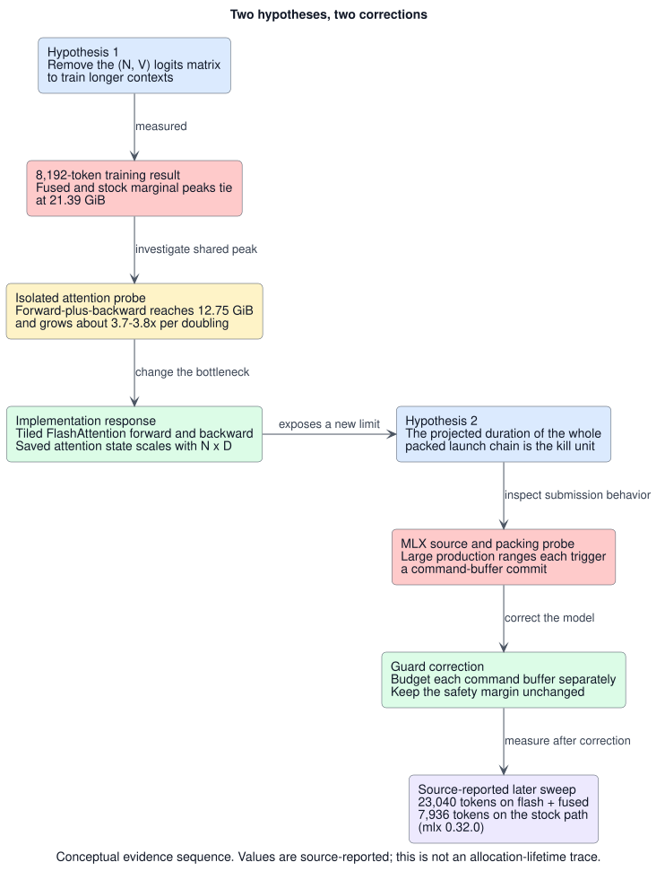

# When the Bottleneck Moved: From Fused Cross-Entropy to FlashAttention on MLX

*Two corrected system models and a tiled attention path for Apple GPUs*

> 📄 [Read on the website](https://ineshin.space/papers/when-the-bottleneck-moved/) — same paper, formatted for reading.

## Notice, 2026-11-13

On 2026-11-13 the project withdrew figures this paper relies on, among them the 25.68 GiB
training-step peak, the 7,936 and 23,040 token contexts, the ceiling of about 24.5 GiB and section
4's throughput figures ([changelog](https://github.com/IonDen/mlx-train-perf/blob/895957e/CHANGELOG.md)).
This notice also withdraws the 21.39 GiB tie between fused and stock loss on MLX 0.31.2. None of
these, and none of the other MLX 0.31.2 measurements in sections 1 and 2, is in a record published
with the code; they cannot be checked against any published record. Do not rely on the figures after
the update section below; for published numbers, see the
[fused-loss paper](https://github.com/IonDen/mlx-train-perf/blob/main/docs/papers/fused-linear-cross-entropy-apple-gpus.md),
the [command-buffer paper](https://github.com/IonDen/mlx-train-perf/blob/main/docs/papers/how-mlx-packs-metal-command-buffers.md),
and the README's
[fused-loss section](https://github.com/IonDen/mlx-train-perf/blob/895957e/README.md#the-fused-cross-entropy-loss)
and [attention-memory tables](https://github.com/IonDen/mlx-train-perf/blob/895957e/README.md#attention-memory-on-mlx-0320-and-0324).

## Update, 2026-11-13: what changed in MLX 0.32.4

On MLX 0.32.4 the tiled flash-attention path keeps a large memory advantage at 8,192 tokens only
for packed batches. This paper's measurements are from MLX 0.32.0, or 0.31.2 where noted. Both
headline comparisons it took from the release
[README](https://github.com/IonDen/mlx-train-perf/blob/v0.3.1/README.md) are withdrawn (see the
notice above): 12.75 GiB with flash attention and the fused loss against 25.68 GiB with stock
attention for a training step at 8,192 tokens, and 23,040 against 7,936 tokens for the largest
completed two-step probe. Only the 12.75 GiB figure keeps a published record
([`_artifacts/bench_train_step_flash/`](https://github.com/IonDen/mlx-train-perf/tree/v0.9.1/_artifacts/bench_train_step_flash)),
and there its pair is 15.92 GiB for the stock loss, both under flash attention. No published step
record uses stock attention.

MLX 0.32.4 added a stock attention backward
([ml-explore/mlx#4563](https://github.com/ml-explore/mlx/pull/4563)). In the library's later
attention benchmark ([0.9.1 changelog](https://github.com/IonDen/mlx-train-perf/blob/v0.9.1/CHANGELOG.md)),
one causal forward plus backward at 8,192 tokens on 0.32.4 peaks at 0.682 GiB stock against
0.596 GiB flash; on MLX 0.32.0 stock peaks at 12.532 GiB. A packed (block-diagonal) mask keeps the
stock backward quadratic on 0.32.4: 12.469 against 0.659 GiB. At 1,024 tokens causal stock still uses 4.6×
more. Unmasked attention was not measured. The library still pins MLX 0.32.0 and refuses flash on
0.32.4, so all 0.32.4 rows used a measurement-only override. This benchmark is neither section
2's inline probe on MLX 0.31.2 nor section 4's 0.721 GiB single-op run.

When you remove a bottleneck, measure what replaced it: here the stock attention backward, which
0.32.4 lightened for causal masks, not packed ones.

---

Removing a large allocation does not necessarily move a system's memory ceiling. It moves the
ceiling only when that allocation is alive at the peak.

That distinction cost `mlx-train-perf` its first product hypothesis. A fused linear cross-entropy forward
removed the `(tokens, vocabulary)` logits matrix, and at moderate sequence lengths an end-to-end
training run used less memory. We expected the saving to extend the longest context that fit on a
32 GB Mac. It did not. At 8192 tokens on MLX 0.31.2, the fused-loss and stock-loss training paths
reached the same 21.39 GiB marginal peak above resident state. Together with that tie, an isolated
attention operation whose forward-plus-backward window peaked at 12.75 GiB on the same release
pointed to the credible dominant shared term: a quadratic-memory attention backward, which stock
attention had on MLX 0.31.2 and 0.32.0. The experiments
did not directly trace the lifetime of the loss buffers, so they do not establish the ordering or
overlap of the loss and attention peaks.

The next implementation replaced that quadratic-memory backward with tiled recomputation on Metal.
At 8192 tokens on MLX 0.32.0, the release documents report a 12.75 GiB total peak with flash
attention against 25.68 GiB with stock attention; the project's unpublished benchmark record pairs
them with the fused and the stock loss respectively. This full-product comparison changes two
components at once, and the public evidence does not contain a complete memory 2×2 (both
attention paths crossed with both loss paths) that could assign an order-independent share to
either component. Neither this comparison nor the context sweep below was re-measured on MLX
0.32.4 (see the update above).

One more model then failed. The first release of the flash path capped the total projected duration of
a chained Metal launch. MLX source inspection and a dedicated packing probe showed that successive
large production ranges cannot share one command buffer under the pinned scheduler thresholds, so a
chain-total cap did not model how MLX submitted that work. Smaller framework work may still precede
the range in the buffer it closes. The evidence is consistent with command-buffer occupancy being
relevant to macOS interactivity kills, but it does not directly observe the operating system's
decision rule.

The project [README](https://github.com/IonDen/mlx-train-perf/blob/v0.3.1/README.md) and [changelog](https://github.com/IonDen/mlx-train-perf/blob/v0.3.1/CHANGELOG.md) report a later context sweep on MLX 0.32.0 reaching 23,040 tokens on the
flash-plus-fused path versus 7,936 on the stock path on the same M1 Max. This article treats the
step peaks and the sweep as source-reported measurements; it does not independently rerun the
benchmark. The public release record
does not include the raw failed probes above 23,040, so it cannot establish a pure post-correction
memory frontier for an outside reader.

This paper is a case study in bottleneck migration and measurement correction. It does not claim a new
attention algorithm: the online-softmax and recompute schedule comes from
[FlashAttention](https://arxiv.org/abs/2205.14135). The contribution is not the first Metal or MLX
FlashAttention implementation. It is a causal grouped-query-attention (GQA) training integration for
Qwen/Llama-class `mlx-lm` fine-tuning on pre-NAX Apple hardware, the generations before the M5's
Neural Accelerators, together with the evidence trail showing how two plausible system models failed.



*Figure 1. Two measured corrections changed the implementation. The sequence is conceptual, the
values are source-reported (the 21.39 GiB tie and the 12.75 GiB isolated attention peak on MLX
0.31.2; the 23,040 against 7,936 sweep on MLX 0.32.0), and the figure does not claim an
allocation-lifetime trace. The editable
[PlantUML source](https://github.com/IonDen/mlx-train-perf/blob/main/docs/papers/diagrams/bottleneck-migration-evidence-flow.puml)
is published with the paper.*

## 1. The first hypothesis: remove logits, train longer

For sequence length `N`, hidden dimension `D`, and vocabulary size `V`, a conventional output layer
forms logits with shape `(N, V)`:

```text
logits = hidden @ W.T
loss_i = logsumexp(logits_i) - logits_i,target_i
```

The fused loss avoids that matrix. It streams over vocabulary tiles, updates an online log-sum-exp,
captures the target logit, and returns only per-token vectors. This removes a real allocation. The
initial product hypothesis went one step further: if logits disappear, a longer sequence should fit
before the machine runs out of memory.

We tested that prediction on an Apple M1 Max with 32 GB unified memory using MLX 0.31.2,
`mlx-lm` 0.31.3, and `mlx-community/Qwen3-8B-4bit`. Both arms used batch 1, LoRA rank 8 across all
layers, bfloat16 compute, AdamW, gradient checkpointing, and the compiled `mlx-lm` training loop.
Every context probe ran in a separate subprocess and executed two real fine-tuning steps. The search
doubled the context and then bisected to a 256-token granularity.

The result contradicted the hypothesis. The values below, from the earlier run described after
the table, are
**source-reported marginal peaks** above roughly 4.29 GiB of resident model state; later tables use a
different metric, the total peak:

| sequence length | fused-loss marginal peak | stock-loss marginal peak | difference |
|---:|---:|---:|---:|
| 1,024 | 2.15 GiB | 2.12 GiB | +0.04 GiB |
| 2,048 | 3.03 GiB | 3.75 GiB | −0.72 GiB |
| 4,096 | 6.96 GiB | 7.48 GiB | −0.52 GiB |
| 8,192 | 21.39 GiB | 21.39 GiB | 0.00 GiB |

The fused path helped at 2,048 and 4,096 tokens. By 8,192, the reported marginal peaks were equal at
the available precision. The largest successful contexts were 8,448 for the fused path and 8,704 for
stock, one search step apart and reversed from the prediction. The honest interpretation was a tie,
not a small loss for fusion.

These values come from an earlier measurement run whose raw artifacts and driver were not
published with the code; the environment, search procedure, and result table summarized here are
that run's. The table is therefore an
attributed historical result, not an independently reproducible result from the current repository.

This experiment also corrected the meaning of an earlier measurement: the loss layer in isolation,
where the fused kernel's marginal memory had looked far smaller than stock's. That isolated ratio
used unequal warmed baselines and is not a sound end-to-end multiplier. The 0.72 GiB saving at a 2,048-token training point is a more relevant
observation: real memory was freed at that shape, but the long-context high-water mark was dominated
by a shared term. Proving the exact allocation lifetime would require phase-scoped instrumentation.

## 2. Finding the allocation that replaced it

The shape of the training curve pointed away from vocabulary logits. When `N` doubled from 2,048 to
4,096 and then 8,192, the peak grew much faster than linearly. Both loss arms converged on the same
curve. That supports a shared dominant term but does not identify allocation lifetimes.

A direct scaled-dot-product-attention experiment measured the candidate term: an inline
experiment with one causal `mx.fast.scaled_dot_product_attention` operation, 32 heads, head
dimension 128, and bfloat16 inputs, from an earlier measurement run whose raw artifacts and driver
were not published with the code. It evaluated materialized inputs, cleared the cache, reset MLX's
peak-memory counter, and measured forward-only and gradient evaluations separately. On MLX 0.31.2
and 0.32.0, this fast path had a memory-light forward, but its training backward fell back to an
unfused implementation (MLX 0.32.4 added a backward for it,
[ml-explore/mlx#4563](https://github.com/ml-explore/mlx/pull/4563)). The table below was measured
on MLX 0.31.2:

| sequence length | forward peak | forward-plus-backward peak |
|---:|---:|---:|
| 2,048 | 96 MiB | 924 MiB |
| 4,096 | 192 MiB | 3,408 MiB |
| 8,192 | 384 MiB | 13,057 MiB |

Forward memory doubled with `N`; forward-plus-backward memory grew by about 3.7 to 3.8× per doubling.
At 8,192 tokens, the isolated attention operation's full forward-plus-backward window reached about
12.75 GiB. Three observations support attention backward as the credible shared bottleneck: the
operation's scale and rapid growth, the converging loss-arm curves, and the later attention
intervention. They do not establish
when the loss buffers were released or whether the two peaks overlapped.

The behavior also matched pinned MLX source. In [MLX 0.31.2](https://github.com/ml-explore/mlx/blob/v0.31.2/mlx/backend/metal/scaled_dot_product_attention.cpp#L788-L795)
and [MLX 0.32.0](https://github.com/ml-explore/mlx/blob/v0.32.0/mlx/backend/metal/scaled_dot_product_attention.cpp#L591-L607),
the Metal fast-SDPA training path fell back, and the
[0.32.0 VJP GPU implementation](https://github.com/ml-explore/mlx/blob/v0.32.0/mlx/backend/metal/scaled_dot_product_attention.cpp#L792-L799)
was marked `NYI` (not yet implemented). On those two releases, the missing component was a
memory-efficient attention backward, not another loss optimization. MLX 0.32.4's backward is far
lighter with a causal mask (see the update above).

## 3. What the FlashAttention schedule changes

For one attention head, standard scaled dot-product attention is

```text
S = scale · Q Kᵀ + mask
P = softmax(S)
O = P V
```

A straightforward training implementation stores or reconstructs an `(N, N)` score or probability
matrix. FlashAttention changes the schedule rather than the result. It processes query and key/value
blocks, keeps softmax state on chip, and writes only the output and one log-sum-exp (LSE) value per
query row.

For a score tile `S_ij`, the forward tracks a row maximum `m`, a scaled denominator `l`, and an
unnormalized output accumulator `acc`:

```text
m_new   = max(m_old, rowmax(S_ij))
alpha   = exp(m_old - m_new)
p       = exp(S_ij - m_new)
l_new   = alpha · l_old + rowsum(p)
acc_new = alpha · acc_old + p V_j
```

After all visible key blocks:

```text
O_i = acc / l
L_i = m + log(l)
```

The backward saves `O` and `L`, not `P`. It recomputes each probability tile as

```text
P_ij = exp(scale · Q_i K_jᵀ + mask_ij - L_i)
```

and accumulates `dQ`, `dK`, and `dV` tile by tile. The saved attention state is proportional to
`N·D`, rather than `N²`. This is algorithmic saved-state complexity; it does not imply that every
measured device peak must double exactly when `N` doubles. Temporary outputs, split reductions,
allocator state, and the rest of the training step remain visible to the measurement.

The first MLX/Metal implementation supported causal training attention for Llama and Qwen3-style
layouts, including grouped-query attention. Its forward wrote `O` and `L`. The backward used a small
preprocess for `D_i = dot(dO_i, O_i)`, a query-owned `dQ` path, and split/reduced `dK` and `dV` work.
Unsupported masks, dropout, head dimensions, model families, and inference caches failed with typed
errors instead of silently changing implementation.

The released correctness evidence separates into four checks, each with its own comparator and scope:

| check | comparator | documented result |
|---|---|---|
| attention forward | pure-MLX math, MLX SDPA, and fp32 LSE references | max-absolute-error gates: O `<2e-6` fp32 / `<1.2e-2` bf16; LSE `<2e-6` / `<5e-6` |
| attention backward (`dQ`, `dK`, `dV`) | pure-MLX autodiff oracle | max-absolute-error gates: dQ `<5e-6` fp32 / `<3e-2` bf16; dK/dV `<2.5e-5` / `<1e-1` |
| integrated training loss | stock trainer under matched bf16 conditions | source-reported worst per-step difference: `2.4e-3`; pair/step count not published |
| unsupported attention modes | explicit capability checks | typed error rather than silent fallback |

The release-tagged [forward](https://github.com/IonDen/mlx-train-perf/blob/v0.2.0/tests/test_attention_kernel_fwd.py#L377-L457)
and [backward](https://github.com/IonDen/mlx-train-perf/blob/v0.2.0/tests/test_attention_kernel_bwd.py#L348-L676)
grids cover causal MHA and GQA, sequence lengths 61, 64, and 257, head dimensions 64 and 128, batches
1 and 2, and fp32/bf16 inputs; the 32-query/8-KV-head pattern is included at length 64. These are
acceptance tolerances, not production-shape observed maxima. The `2.4e-3` figure measures integrated
loss-curve agreement, not elementwise attention error.

## 4. Separating the attention win from the loss win

The 0.2 release benchmark used MLX 0.32.0 on the same 32 GB M1 Max, with Qwen3-8B-4bit, batch 1,
LoRA rank 8, bfloat16 compute, and gradient checkpointing. The public [README](https://github.com/IonDen/mlx-train-perf/blob/v0.3.1/README.md) and
[changelog](https://github.com/IonDen/mlx-train-perf/blob/v0.3.1/CHANGELOG.md) report the following 8,192-token outcomes; the raw train-step JSON is
not committed, so values are rounded to the public release precision. The two documents name the
loss arm of each throughput figure and of the abort, but give the two total peaks only by
attention arm; their loss-arm labels come from the project's unpublished benchmark record. The
flash plus fused-loss throughput is published only as a ratio: under flash attention, the fused
loss ran at 0.99× the stock loss's tokens per second at 8,192 tokens.

| attention | loss | status | total peak | median throughput |
|---|---|---|---:|---:|
| stock | stock | completed | 25.68 GiB | 78.1 tok/s |
| stock | fused | memory-watchdog abort | not available | not available |
| flash | stock | completed | not published | 74.0 tok/s |
| flash | fused | completed | 12.75 GiB | 0.99× flash + stock loss |

The full-product comparison, flash plus fused loss against stock attention plus stock loss, was close
to a twofold reduction in total peak. It changed two components at once. The fixed-stock-loss
throughput comparison establishes that both attention paths ran, but its flash memory value is not in
the public release evidence. Because one cell aborted and the public bundle lacks a complete memory
2×2, the experiment cannot estimate interaction or assign an order-independent share of the full
reduction to either component.

The stock-attention plus fused-loss cell aborted while the stock-loss cell completed. The release
documents do not expose enough session state to explain that ordering as a monotonic allocation result.
The missing cell must remain missing; it cannot be reconstructed from the other three.

The [committed single-op reproduction](https://github.com/IonDen/mlx-train-perf/blob/v0.3.1/community-benchmarks/apple-m1-max-32gb-2026-07-13.json)
compares the flash kernel with the project's materialized
pure-MLX mathematical reference. It does **not** measure `mx.fast.scaled_dot_product_attention` and
must not be read as an installed-MLX stock-path comparison. Its values are marginal device peaks
after implementation-specific warm-up and an active-memory baseline reset:

| sequence length | flash marginal peak | pure-MLX reference marginal peak |
|---:|---:|---:|
| 2,048 | 0.118 GiB | 2.821 GiB |
| 4,096 | 0.235 GiB | 10.610 GiB |
| 8,192 | 0.721 GiB | memory-watchdog abort at 32.53 GiB active |

The flash measurements are consistent with the intended linear saved-state design, but three points
do not constitute an asymptotic proof. The 4,096→8,192 measured peak grows by 3.06× because the metric
includes more than the persistent `O` and `L` arrays. The safe claim is that the implementation avoids
the full score matrix and measured far below the project's pure-MLX reference at the tested
long-context shapes. That reference is not stock `mx.fast.scaled_dot_product_attention`; the
update above gives the stock call's figures on MLX 0.32.0 and 0.32.4.

## 5. The second wrong model: budgeting the whole chain

The project treated long-running Metal work as an interactivity and kill risk. Its operating
hypothesis was that sufficiently long non-preemptible GPU work could starve display compositing, but
the available evidence did not directly establish preemption behavior, starvation causality, or the
macOS kill unit. The 0.2 implementation therefore estimated kernel duration and split work before a
dispatch crossed its conservative budget.

The original guard also capped an entire chained backward at two projected seconds. Its model assumed
that MLX packed consecutive custom-kernel dispatches into one command buffer and treated the whole
packed chain as the safety unit. This cap refused flash-attention contexts near 10,000 tokens even
though their memory peaks remained well below the machine ceiling. The result looked like a new
bottleneck: fusion removed the quadratic memory limit, only to expose a RAM-independent launch limit.

That explanation was wrong.

MLX 0.32.0's Metal scheduler [commits after encoding](https://github.com/ml-explore/mlx/blob/v0.32.0/mlx/backend/metal/device.cpp#L512-L515)
when more than 50 operations or more than roughly 50 million unique input/output elements have
accumulated on the M1 Max architecture class. Its source counts
[backing-buffer identities](https://github.com/ml-explore/mlx/blob/v0.32.0/mlx/backend/metal/device.cpp#L343-L368),
not semantic tensor liveness. At the 8,192-token training shape, a single `dK/dV` range touches about
118 million elements and a `dQ` range about 85 to 89 million. Successive ranges of that size therefore
cannot share one command buffer: each triggers a commit after it is encoded, although smaller preceding
work may share the buffer it closes. The chain total is not the duration of one command buffer.

The project's recorded behavioral probe, not rerun here, follows the method of the public
[`probe_command_buffer_packing.py`](https://github.com/IonDen/mlx-train-perf/blob/v0.3.1/scripts/probe_command_buffer_packing.py)
and was consistent with the operation-count threshold being active in the shipped wheel. Forcing
a commit after every operation made a chain of 2,000 tiny serial matrix multiplies clearly slower.
Raising the operation threshold did not make the chain faster, so the probe does not isolate the
per-commit overhead. For a chain of large additions, the three size-threshold settings were within
a small spread, so the element threshold rests on the source reading above. A separate `N=12,288`
chained `dK/dV` probe, whose total projected time exceeded the retired chain cap, completed with
finite outputs. The raw probe record is not in the public bundle.

The corrected guard models work per command buffer. It keeps the worst-day safety margin for each
buffer and accounts for small dispatches that can still pack together. No safety margin was raised.
This is a source-grounded conservative model, not a direct measurement of the macOS watchdog's
internal decision boundary.

## 6. The source-reported context sweep

After the guard correction, the project ran the sweep that its
[README](https://github.com/IonDen/mlx-train-perf/blob/v0.3.1/README.md) and
[changelog](https://github.com/IonDen/mlx-train-perf/blob/v0.3.1/CHANGELOG.md) report, on MLX
0.32.0: Qwen3-8B-4bit QLoRA, batch 1, LoRA rank 8, bfloat16 compute, gradient checkpointing, and
two training steps per isolated probe. The
[sweep driver](https://github.com/IonDen/mlx-train-perf/blob/v0.3.1/scripts/northstar_context_sweep.py)
pairs flash attention with the fused loss and stock attention with the stock loss. The two
documents agree on the following source-reported results, which were not re-measured on MLX 0.32.4:

| path | reported largest completed context | reported peak there |
|---|---:|---:|
| stock attention + stock loss | 7,936 | about 24.5 GiB |
| flash attention + fused loss | 23,040 | about 24.5 GiB |

The ratio of the reported largest completed points is 2.90× on this machine, in this run. It is
not a universal context multiplier. The comparison changes both attention and loss, uses one model and
batch size, and depends on the available-memory ceiling at probe start. Larger-memory hardware was
not measured, and this article did not rerun the sweep.

The release documents call both completed frontiers memory-bounded, but the raw failed probes are not
in the public evidence bundle. The reported ceilings and ratio can therefore be cited as release
results; the precise failure sequence above 23,040 and a pure post-correction memory frontier cannot be
independently verified here.

The supported editorial claim is narrower: the project documents report a two-step execution at
23,040 tokens with roughly the total peak that stock used at 7,936. This is a documented
single-machine result, not an independently reproduced trainability or scaling result.

## 7. Lessons from two displaced bottlenecks

The sequence of experiments supports five conclusions.

First, allocation size is not enough. Lifetime determines whether an optimization changes peak memory.
The logits matrix was large, while the converging train-step curves and isolated attention scaling
identified attention backward as the credible shared bottleneck; their relative phase ordering was not
measured.

Second, component controls matter. The twofold full-product reduction at 8,192 tokens combined fused
loss and flash attention. The isolated attention scaling shows why attention credibly contributes a
substantial share, but the incomplete public 2×2 does not decompose the full reduction.

Third, algorithmic complexity and measured scaling are different statements. FlashAttention keeps
linear saved state, while measured device peaks include temporary reductions, allocator behavior, and
the surrounding training graph.

Fourth, safety models deserve the same empirical scrutiny as performance models. The per-chain guard
was conservative but did not match observed MLX submission boundaries. It blocked valid observed
work; the stronger claim about the exact macOS watchdog unit remains an inference.

Finally, failed and refused cells are part of the result. A watchdog abort, a launch refusal, and a
successful measurement answer different questions. Collapsing all three into "does not fit" hides the
mechanism that should guide the next design.

## 8. Limitations and reproducibility

The evidence comes from one M1 Max with 32 GB unified memory, two pinned MLX releases, one flagship
Qwen3 recipe, and short two-step context probes. Absolute ceilings depend on machine availability,
thermal and display state, software versions, and the active safety ceiling. The context sweep measures
two short steps, not training quality over a meaningful optimization run. This article compares
the figures with the project's own release documents and does not rerun the research code.

The algorithms and benchmark drivers are public in this repository:

- [`scripts/bench_attention_op.py`](https://github.com/IonDen/mlx-train-perf/blob/v0.3.1/scripts/bench_attention_op.py) measures isolated attention memory and wall time.
- [`scripts/bench_train_step.py`](https://github.com/IonDen/mlx-train-perf/blob/v0.3.1/scripts/bench_train_step.py) measures the attention/loss combinations.
- [`scripts/northstar_context_sweep.py`](https://github.com/IonDen/mlx-train-perf/blob/v0.3.1/scripts/northstar_context_sweep.py) performs the context search.
- [`scripts/probe_command_buffer_packing.py`](https://github.com/IonDen/mlx-train-perf/blob/v0.3.1/scripts/probe_command_buffer_packing.py) tests the scheduler model.

The [committed community artifact](https://github.com/IonDen/mlx-train-perf/blob/v0.3.1/community-benchmarks/apple-m1-max-32gb-2026-07-13.json)
contains the MLX 0.32.0 single-op measurements through 8,192 tokens. The release
[README](https://github.com/IonDen/mlx-train-perf/blob/v0.3.1/README.md) and [changelog](https://github.com/IonDen/mlx-train-perf/blob/v0.3.1/CHANGELOG.md) record the train-step and context results.
Raw JSON for the train-step, context-sweep, and command-buffer campaigns is not part of the public
evidence bundle, so this is a source-based technical article, not an independently reproducible
benchmark report.

### Related work

[FlashAttention](https://arxiv.org/abs/2205.14135) introduced the IO-aware exact tiled
algorithm for the quadratic attention-memory bottleneck this paper targets;
[FlashAttention-2](https://arxiv.org/abs/2307.08691) improved work partitioning and reduced
non-matrix-multiply overhead. [Cut Cross-Entropy](https://arxiv.org/abs/2411.09009) and
[Liger-Kernel](https://github.com/linkedin/Liger-Kernel) address the separate `(tokens, vocabulary)`
logits bottleneck. Their relevance here is the systems interaction: removing loss-layer materialization
does not increase end-to-end context when an O(N²)-memory attention backward becomes the next peak
(as on MLX 0.31.2 and 0.32.0).

Closer Apple-platform implementations predate this work. [Metal FlashAttention 2.0](https://engineering.drawthings.ai/p/metal-flashattention-2-0-pushing-forward-on-device-inference-training-on-apple-silicon-fe8aac1ab23c)
published Swift/C++ Metal kernels and an experimental backward for diffusion training in January 2025.
[`mlx-mfa` 2.37.1](https://pypi.org/project/mlx-mfa/2.37.1/) was already an MLX attention runtime with
training support by May 2026; its native NAX backward was opt-in on M5+ for a restricted non-causal
fp16/bf16 envelope, with other paths using SDPA VJP. The implementation studied here instead targets
native causal MHA/GQA forward and backward on an M1 Max and integrates it into Qwen/Llama `mlx-lm`
QLoRA. It does not claim first implementation, parity with optimized CUDA throughput, or support for
arbitrary attention modes.

---

*Prepared 2026-07-14. Last updated 2026-11-13. Denis Ineshin.*
